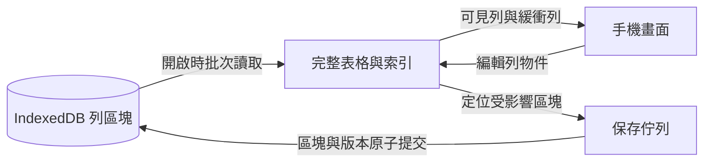

# 一萬列工作區的本機儲存架構提案

2026-10-04。以 `426c2cc` 的工作區程式為基準。本文是設計與診斷原型的結論，正式儲存格式、畫面及線上版本尚未套用。設計範圍是 IndexedDB 的資料配置與讀寫流程，不承諾已超越手機試算表的整體效能。

建議保留「使用中的完整表格在記憶體中、畫面只渲染可見列與緩衝列」，將持久化改成固定 ID 的列區塊。預設每區塊最多 256 列，列的顯示順序獨立保存。單格編輯保存一個區塊；拖曳排序保存順序；匯入或真正影響所有列的操作才批次保存所有區塊。

**決策依據與量測範圍。**

先前同一份短 ID、12 個短文字欄位的資料，逐列 `getAll()` 在一萬列時比整表慢。CPU 模擬降速四倍，讀取、組裝及既有正規化合計，整表約 64.3 ms、逐列約 124.2 ms、256 列區塊約 72.4 ms。這支持採用區塊，不支持直接把所有儲存格或列拆成大量獨立紀錄。

本次另建較接近提案的原型：使用正式 `makeId()` 產生 UUID 列／欄 ID、固定 UUID 區塊 ID、獨立 `rowOrder`、小型 table state、實際 IndexedDB transaction，以及 transaction 內的全域 revision 檢查。整表基準也已省略 JSON 內容比對，以免把省略比對的收益錯算成區塊收益。

| 配置 | 一萬列讀取與索引，1× CPU | 單格保存，1× CPU | 一萬列讀取與索引，4× CPU | 單格保存，4× CPU |
| --- | ---: | ---: | ---: | ---: |
| 整表一筆，不比對 JSON | 16.1 ms | 18.7 ms | 52.3 ms | 50.1 ms |
| 每區塊 64 列 | 31.9 ms | 0.3 ms | 77.9 ms | 1.2 ms |
| 每區塊 128 列 | 19.2 ms | 0.6 ms | 69.0 ms | 1.8 ms |
| 每區塊 256 列 | 18.2 ms | 0.7 ms | 61.3 ms | 2.5 ms |
| 每區塊 512 列 | 18.6 ms | 1.1 ms | 61.1 ms | 3.8 ms |

256 列原型在 4× CPU 下，頂端新增、刪除、整體順序反轉的持久化中位數分別約 3.4、3.7、3.4 ms。新增／刪除使用既有區塊空位，不移動其餘列的區塊歸屬；順序反轉沒有寫入資料區塊。

這組數字來自桌面 headless Chrome、390×844 viewport、暖快取，四倍降速是比較工具，不能當作實機手機。每種條件三個新 browser context，交錯測試順序；每個操作三次暖身、九次量測，合併 27 次樣本取中位數。讀取含建立 row map、區塊位置索引、檢查列／區塊完整性；不含正式頁面的模組、UI、布局與載入正規化。保存含 revision 讀取、資料／metadata 的 put 及 transaction 完成；不含 UI 陣列更新、寫入計畫準備與操作歷史。原型每次驗證最後的列數、列順序、值、revision 和寫入紀錄數，並未實作遷移、配額失敗、空區塊回收或滿區塊配置。

另外做了較寬資料的敏感度測試：一萬列、24 欄，每格 64 個中文字加上辨識尾碼。4× CPU 下，整表讀取與索引約 143.1 ms、單格保存約 181.3 ms；256 列區塊約 172.3／6.8 ms；128 列區塊約 179.9／3.6 ms。此組僅一個 context、兩次暖身、六次樣本，不能當作可靠的手機或 RAM 基準。它說明欄數、字串大小也要納入驗收，不能把「一萬列」視為固定資料量。

原始診斷程式與資料位於本機 `outputs/workspace-layout-20261004/`、`outputs/workspace-architecture-20261004/`，不作為程式或本文的必要依賴。

**分開處理記憶體、畫面與持久化。**

| 層次 | 資料單位 | 目的 |
| --- | --- | --- |
| 記憶體 | 使用中表格的完整列物件與順序 | 滑動、搜尋與排序不等待 IndexedDB |
| 畫面 | 可見列與既有緩衝列 | 控制 DOM 與布局成本 |
| 持久化 | 最多 256 列的區塊，加少量 metadata | 控制每次編輯的序列化與寫入量 |

第一階段保留現有 `WorkspaceTable`／`WorkspaceData` 對畫面與匯出介面的形狀。這也保留現有單格更新複製一萬個列參照的 O(R) 成本；提案消除的是儲存時遍歷、序列化整表值的工作，不是宣稱整個編輯流程已變成 O(1)。

儲存適配器維護 `chunkId → chunk snapshot` 與 `rowId → { chunkId, slot }`。區塊陣列與畫面陣列引用相同的列物件；修改時只替換修改列及其區塊陣列，不建立第二份深拷貝的儲存格資料，也不快取全部格式化列文字。首載用一次遍歷建立索引，之後單格只更新對應位置；刪除則更新該區塊內受影響的位置。



**目標資料庫格式。**

IndexedDB schema 從目前版本 3 升為版本 4；這與 XLSX／ZIP／Drive 的公開 workspace format version 1 分開。不改公開匯出格式，不把區塊 ID 帶入交換檔案。

| Object store／key | 保存內容 | 一般單格編輯是否寫入 |
| --- | --- | --- |
| `meta["workspace"]` | nodes、activeNodeId、bottomNavigationTableIds、structureRevision、workspace version | 否 |
| `meta["storage"]` | storageRevision、workspace updatedAt | 是，小型紀錄 |
| `tables[tableId]` | 表格定義、rowOrder、chunkIds、chunkCapacity、儲存格式識別 | 否 |
| `tableState[tableId]` | table updatedAt、changeRevision | 是，小型紀錄 |
| `rowChunks[[tableId, chunkId]]` | 區塊列物件 | 是，只寫受影響區塊 |
| `history[tableId]` | past／future 的 entry ID 與 createdAt 清單 | 是，小型紀錄 |
| `historyEntries[[tableId, entryId]]` | 單次操作的 action、label、createdAt 等 | 是，只寫新操作 |
| `state["workspace"]` | 既有舊格式相容來源 | 遷移完成後移除 |

`tables` 的表格定義包含名稱、row header、columns、textScale、transposed，排除 rows、updatedAt、changeRevision。定義與順序共用一筆紀錄，降低第一版 schema 複雜度；欄位名稱或設定改變時會一併寫入 row ID 清單，但不寫入所有儲存格值。若量測證實這部分有成本，再將定義與 layout 拆開。

```ts
type StoredTable = {
  storageFormat: 'row-chunks-v1';
  definition: Omit<WorkspaceTable, 'rows' | 'updatedAt' | 'changeRevision'>;
  chunkCapacity: 128 | 256;
  chunkIds: string[];
  rowOrder: string[];
};

type StoredRowChunk = {
  tableId: string;
  chunkId: string;
  rows: WorkspaceRow[];
};

type StoredTableState = {
  updatedAt: number;
  changeRevision?: string;
};
```

初版預設容量為 256。目標格式容許 128，作為寬表／長文字量測後的調整選項。容量是建立或重新整理表格時的設定，不能在每次編輯時重新估計、重新切整表。256 是列數上限，不是固定 byte 大小或任何手機上的耗時保證。

**區塊歸屬與列順序分離。**

區塊 ID 為固定 UUID，不等於畫面列索引。列歸屬在新增、還原被刪除的列、完整匯入或明確重整時配置；普通編輯與拖曳排序保持歸屬，拖曳只更新 `rowOrder`。首載把區塊內容放入 row map，再按照 rowOrder 取得列物件，組裝既有 `table.rows`。必須驗證區塊目錄、列 ID 唯一性、順序及資料完整性，缺少紀錄時報錯，不將缺列當成空值。

新增列優先放入任一有容量的既有區塊，並插入 rowOrder 的指定位置；無空位才建立新區塊。因為實體歸屬不等於邏輯順序，放進尾端區塊的列可以顯示在最前面，不需要搬動一萬列。刪除列只改所在區塊與 rowOrder；區塊空了就刪除紀錄與目錄項目。刪除後的空位可供往後新增使用，不在每次刪除時做全表壓縮。

第一版不實作 B-tree 分裂、背景重分塊、全表快照加變更日誌或 lazy column tombstone。這些增加恢復／維護成本；已量測的區塊方案足以作為起點。經大量刪除仍留下許多小區塊時，可以日後加入明確的表格重新整理，但不能放入一般保存路徑。

**讀取流程與開啟成本。**

1. 等待同一保存佇列中的已排程保存，讀取 workspace metadata。
2. 優先讀取 active table 的定義、table state、所有 rowChunks，在同一 readonly transaction 取得一致的版本。使用 key range 的批次 getAll，不逐列發出 request。
3. 檢查資料完整性，建立 row map／row location，依 rowOrder 組出完整表格。
4. 第一版仍執行既有 normalizeWorkspace，相容舊型別、缺值及欄位設定變更的重載語意。正規化會建立新列物件，因此要將 row map、區塊 snapshot 的列參照更新為正規化後的同一批物件，再建立持久化參照基準與顯示畫面；不能讓畫面與區塊分別保留兩份儲存格資料。原型未量測這個正規化後的參照更新成本。
5. 首次顯示後才讀取其餘表格與操作歷史。剩餘表格只讀尚未載入的 table ID，不重新建立 active table 的列／區塊持久化基準。保留 revision 檢查、早期編輯的參照與 pending history merge。

本次原型資料先正規化，所以表格中的讀取數字沒有重跑 normalizeWorkspace。正式第一版的開啟速度必須按完整流程重新量測，不能直接拿原型數字宣稱完成。省略載入正規化需要另外建立「所有寫入資料已符合 canonical storage 契約」，包括輸入型別切換、匯入與舊資料；本提案不將它計入收益。

對多張一萬列表，第二階段才評估完整 catalog 與按表載入：active table 完整留在記憶體，其餘只保留表格 metadata／revision，切換時讀取並快取。未載入資料必須有明確狀態，不能用 `rows: []` 冒充完整資料；匯出與 Drive 備份必須先 materialize 所需表格。第一階段不引入這個畫面與備份介面變更。

**修改與保存流程。**

儲存命令攜帶 immutable 的修改後 workspace／table／chunk snapshot，以及 mutation 影響範圍。既有 set-cell、set-cells、paste-range 已提供明確 action；undo／redo 亦可使用已知 action。第一階段允許既有 generic commit 對列參照做 O(R) 差異判定，不能退回整表 JSON 內容比對；匯入與 restore 則明確走 replace-table／replace-workspace 路徑。

單格命令拿到修改後列物件，透過 row location 找到區塊，替換該區塊內的列參照，產生新的區塊 snapshot。根 chunk map 在初次配置一萬列時只包含約 40 個項目，更新它不深拷貝整表。大量刪除、歷史最大列數可能使區塊較疏，實際數量也納入驗收。保持既有 React table.rows 介面時，畫面列陣列更新與儲存區塊更新都引用同一修改後列。

同一個全域 saveQueue 串行提交。保存前比較本次 chunk snapshot 與上次成功保存的 chunk reference，檢查約 40 個區塊參照；只序列化不同的區塊，不遍歷區塊內所有值來產生簽章。layout、definition 的參照也分別追蹤，單格不保存一萬個 row ID 的目錄。第一次載入直接建立區塊參照基準，不先建立整表 JSON。

持久化基準只能在 transaction 成功後前進，而且前進到「該次提交的 snapshot」，不能前進到稍後已變更的記憶體資料。失敗後保留基準：例如 A 區塊保存失敗，後續 B 編輯的 snapshot 仍含 A 的未保存區塊，下一次規劃會一併保存 A、B，避免細粒度命令漏掉先前失敗的修改。跨分頁 revision 衝突時停止提交並進入現有衝突處理，不自動覆蓋。

在單一 readwrite transaction 中先讀取 `meta["storage"]` 的 storageRevision，與此分頁最後成功讀取／保存的 revision 比較；相符才寫入受影響 rowChunks、tableState、必要的 layout／definition、history head／new entries 與新的 storageRevision。內容規劃在開啟 transaction 前完成；transaction 內只等待 IndexedDB request，不插入網路或 timer。

畫面可以先顯示編輯結果，但「已儲存」只能在 transaction 完成後顯示；失敗保留目前記憶體資料及錯誤狀態。未載入表格不能因為不在 partial snapshot 裡而被刪除。刪表、清除、匯入替換皆使用明確 table ID／完整替換範圍。

不在第一版加固定秒數 debounce 或靠關閉頁面才保存。先使用小區塊與既有串行佇列；若量測證實連續編輯累積佇列，再研究合併尚未開始的保存計畫，保留所有歷史事件、Promise 完成語意及 flush barrier。

**操作對照與真實的大量修改。**

| 操作 | 資料寫入 |
| --- | --- |
| 單格／列名稱 | 1 個所在區塊，加小型狀態與新歷史事件 |
| 批次編輯／貼上 | 去重後的受影響區塊；新增列、欄另更新目錄／定義 |
| 新增／刪除一列 | 1 個區塊與 rowOrder；必要時新增／刪除區塊目錄項目 |
| 手動拖曳排序 | rowOrder，0 個資料區塊 |
| 搜尋、篩選、欄位值排序 | 現有視圖狀態；不改持久化列順序 |
| 欄名、隱藏、寬度、格式、轉置、欄順序、row header 設定 | 表格定義；維持目前欄位型別變更與重載的契約 |
| 新增／刪除欄 | 第一版維持現在補 null／移除值的行為，批次更新所有受影響區塊 |
| 刪表 | 該表 metadata、所有 chunks／state／history；不碰其他表 |
| 匯入／Drive restore | 完整重建替換範圍的區塊，再原子提交 |
| Undo／redo | 依 action 同上，再原子更新 history head |

新增／刪除欄與全表匯入本來就是大量資料變更，不能承諾和改一格相同成本。先保留資料語意與復原能力，不引入 lazy column/tombstone，避免舊值殘留、欄位 ID 重用與恢復時機的額外契約。

**操作歷史的保存單位。**

目前 history 每表保存整份 past／future，限制為各 50 筆、6 小時；單格事件很小，但 reorder-rows 或 remove-column 事件可能包含一萬列的 ID／值。區塊化後還反覆保存整份歷史，可能形成下一個瓶頸。

目標格式每個事件獨立保存，history head 只保存 entry ID、createdAt 及 past／future 次序。沿用現有各 50 筆及 6 小時契約；新編輯保存新 entry、更新 head，並刪除 redo 分支及過期／超出限制的事件。與資料區塊一起提交，避免資料已保存但對應歷史尚未保存。

事件本身若涉及一萬列，仍需要保存那次操作所需的資訊，不能把大操作偽裝成小事件。載入歷史安排在首次顯示後；讀取 head、批次取得其引用的事件，保留既有 pending history 按 entry ID 合併。歷史尚未載入時的早期編輯，在資料保存的同一 transaction 讀取 head、追加新 entry 並保留既有 past，不以記憶體中尚未完整的清單覆蓋它。舊 full-history record 在初次使用時一次性轉成 head／entries，不於每次修改重新展開。

**遷移、早期編輯與對外格式。**

升級 transaction 只新增 object stores，以及遷移小型 workspace storage revision，不在 schema upgrade 裡遍歷、重寫所有表格。既有 `tables[tableId]` 可暫存舊 WorkspaceTable；新紀錄用 storageFormat 判別，mixed-format reader 允許逐表遷移。

舊 active table 依現有方式載入、正規化並先顯示；之後透過同一 saveQueue 規劃完整區塊布局，單一 transaction 取代該表舊紀錄、建立 state／chunks。舊紀錄在該 transaction 成功前保留；abort 必須保留舊表。早期編輯不得被已準備的遷移快照覆蓋：遷移也以不可變快照排入佇列，其後的編輯沿用該布局並依序提交；如果較早的編輯仍在舊格式，第一個轉換命令使用包含它們的最新完整表格。每個 snapshot／布局的關聯必須在實作測試中證明。

轉換格式更新 storageRevision，但不更改 changeRevision／structureRevision，避免僅因格式遷移觸發 Drive 的語意變更判定。其餘表格在首次顯示後或實際需要保存時轉換；歷史同理。schema versionchange 要關閉舊連線，upgrade 被舊分頁阻擋時提供明確的關閉／重新開啟處理。

本地 row ID 在編輯、拖曳、復原時穩定；目前交換檔解析會重新產生 row ID。匯入與 Drive restore 因此視為完整替換並重新配置 chunks，不嘗試跨交換檔用 row ID 做增量合併。這不需要改 XLSX／ZIP／Drive 格式。匯出使用按 rowOrder materialize 的 WorkspaceTable，Drive dirty 判定仍使用 changeRevision／structureRevision。

**實作與驗收順序。**

1. 實作儲存適配器與 v4 mixed-format reader／逐表 migration。保留 UI 介面、active-first／partial save／hydration 契約、跨分頁 revision guard；移除本機整表 JSON 簽章。
2. 將明確 action 轉成 chunk snapshot，先接單格、批次、貼上及 undo／redo，再接其餘 generic／整表替換入口。建立失敗保存後仍涵蓋先前 dirty chunks 的測試。
3. 接獨立 history entries 與 atomic history／data 提交。資料與歷史 schema、cold history 與早期編輯的遷移必須在同一次功能發布前完成驗證。
4. 在實際 production bundle 做 250／一萬列、12 欄短字串與 24 欄長字串的開啟、編輯、頂端新增／刪除、拖曳、貼上、復原與重載測試；再讓使用者以手機測試。

必要資料正確性檢查包括：區塊 ID 與列 ID 唯一性、目錄與 rowOrder 完整性、跨區塊貼上、滿區塊配置、刪掉最後一列的區塊回收、排序與資料一致、新增／刪除欄與 undo、metadata-only 不寫區塊、transaction abort／quota error、跨分頁拒絕舊 revision、部分載入時保留未載入表格、早期編輯與 hydration、匯入／restore／export roundtrip、舊 schema 被阻擋與 migration abort。

效能驗收要分開記錄首次畫面可用、完整 active table 可用、保存完成、最長主執行緒工作、快速滑動、記憶體與多表背景載入，不用單一微型 benchmark 取代手機體感。一般單格應只寫一個資料區塊，拖曳排序應寫零個資料區塊，頂端新增／刪除不能重寫所有 chunks；這些結構性指標是確定契約。完整開啟的可接受差異需以相同手機、資料、瀏覽器／PWA 版本的前後量測判定，不先訂沒有基準的毫秒目標。

只在後續量測證明需要時評估：按表載入／記憶體淘汰、canonical read fast path、保存計畫合併、worker、大資料匯入的分階段提交。worker 不會消除 payload 的複製成本；完整快照加變更日誌也會增加重播與壓縮成本，均不作為第一版前提。

參考契約：[目前 db.ts](../src/workspace/db.ts)、[history.ts](../src/workspace/history.ts)、[changeRevisions.ts](../src/workspace/changeRevisions.ts)、[WorkspacePage.tsx](../src/pages/WorkspacePage.tsx)、[useWorkspaceActions.ts](../src/workspace/useWorkspaceActions.ts)。IndexedDB transaction 與 upgrade 的語意見 [W3C IndexedDB transactions](https://www.w3.org/TR/IndexedDB/#transaction-concept) 與 [opening a database connection](https://www.w3.org/TR/IndexedDB/#opening-a-database-connection)。
