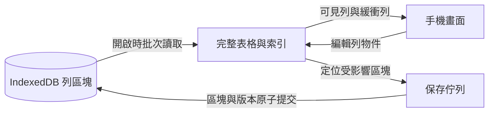

# 一萬列工作區的本機儲存架構

**2026-10-08：資料頁局部保存與精簡拖曳歷史。**

IndexedDB 升至 v6，沿用原有 object stores；升級交易不遍歷或改寫資料頁。表頭新增可選的 `pageRevisions`，逐頁指定內容版本；舊 v5 表頭未提供時，以既有 `layoutRevision` 作為預期頁版本。第一次保存可直接沿用未變動頁的舊版本，無須重寫它們。頁紀錄沿用 `layoutRevision` 欄位名稱表示該頁的內容版本；表頭的 `layoutRevision` 則仍表示顯示順序／列數的布局版本。v6 的版本變更會關閉舊分頁的 DB 連線，防止不理解新頁版本或新歷史格式的程式繼續保存。

保存以最後成功的 snapshot/head 為基準。列順序改變時比較同一顯示位置的列參照與每頁長度，只產生受影響頁；順序不變時維持依變動資料區塊尋找受影響頁的路徑。刪除列後明確刪除超出新列數的頁。一般一萬列尾端新增只寫一個原始區塊與一頁；同頁移動只寫一頁、零個原始區塊；跨頁移動寫實際變動頁，首尾移動仍可能影響全部頁。順序、原始區塊、表頭、頁面版本、歷史與 storage revision 維持同一筆交易，失敗不推進保存基準。

讀取檢查表頭指定的每頁版本，畫面快取只採用版本及列數相符的頁；延遲讀取結果不能混入另一個語意版本。分頁高度索引同時以列數辨識範圍。新拖曳歷史使用 `move-row`／`move-column`，只記錄項目 ID 與移動前後索引；舊 `reorder-rows`／`reorder-columns` 的完整 ID 順序仍可復原／重做。動態列表統計在兩種排序紀錄下都保留既有計數，不掃描欄值。

結構操作仍有列陣列、順序、索引與頁差異的線性遍歷；本次減少的是內容序列化與實際寫入量，沒有宣稱新增／排序的所有計算都成為固定成本。匯出、備份與原始資料格式維持不變。

驗證：981 項單元測試（152 檔）、59 項手機尺寸瀏覽器測試、型別檢查與建置通過，維護檔最大 567 行。瀏覽器測試確認 v5→v6 升級不寫入任何資料、不新增 stores；舊頁與排序歷史仍可讀取。頁面寫入遭交易中止或 quota error 後，原始區塊、頁、表頭、歷史與 storage revision 都維持舊狀態；後續保存能同時補回較早的新增與較新的單格編輯。

本機 Chrome、390×844 視窗、4× CPU 降速、12 欄短字串的保存原型比較如下。每項先暖身一次，再取五次中位數；計時包含資料操作、歷史準備與保存完成，未包含 React 畫面更新，不能視為真實手機的操作延遲保證。基準使用修改前的 DB／資料頁規劃及完整排序歷史，新版使用局部頁與精簡移動紀錄。

| 初始列數 | 尾端新增：舊→新 | 同頁拖曳：舊→新 | 相鄰跨頁拖曳：舊→新 |
|---|---|---|---|
| 260 | 5.4→2.6 ms | 4.4→3.1 ms | 5.0→4.0 ms |
| 2,000 | 24.5→6.2 ms | 24.1→4.0 ms | 21.5→5.2 ms |
| 10,000 | 110.0→11.8 ms | 119.3→8.9 ms | 124.1→11.3 ms |

舊版每次分別寫 3／16／79 頁，新版尾端新增與同頁拖曳均寫 1 頁、相鄰跨頁拖曳寫 2 頁。量測中的列數會隨暖身及新增樣本略增，兩版使用相同操作序列。真正手機上的畫面更新與長文字／寬表仍需另外量測。

**2026-10-08：結構操作共用資料轉換與明確紀錄。**

新增／刪除列或欄位直接建立既有操作歷史紀錄，並與重做共用同一套資料轉換，不再從前後整張表推測這四種操作。刪除確認時從目前儲存狀態取得最新列／欄位位置、設定與值；切表或目標已不存在時不提交，避免舊彈窗快照覆蓋後續修改。

欄位鍵移除集中處理，供刪除欄位、復原新增欄位及復原貼上共用。稀疏資料中原本沒有該欄位鍵的列保留原參照，原始區塊和讀取頁只寫入實際受影響範圍；明確存有 `null` 的鍵仍須移除。所有列都含有該欄位的表格仍需更新全部受影響資料；結構操作的列順序檢查也仍為線性遍歷。歷史和資料庫格式維持不變，刪除欄位的復原仍依既有快照將缺少的值還原為明確的 `null`。

**2026-10-08：排序直接記錄，貼上重做使用線性查找。**

拖曳列或欄位後，直接提交前後 ID 順序的操作紀錄，不再由前後表格推測排序；未改變順序或目標已不存在時不保存。貼上重做先建立現有 ID 集合，再追加缺少的列與欄位，將辨識成本從現有數量乘以新增數量，改為兩者相加。列／欄位復原插入也合併重複的陣列複製。重新排序仍需更新列順序及資料頁，資料庫和歷史格式維持不變。

**2026-10-08：共用儲存格變更與局部保存。**

單格、批次、貼上、隱藏欄位保存與復原／重做，共用純函式套用原始值變更；未修改列保留原參照，貼上不再先複製整表的列物件。隱藏欄位的一次保存改為一筆可完整復原的提交，沿用既有多欄位差異格式。已準備完成的未變更表格略過動態列表快取準備，舊表缺少統計的補建行為保留。列陣列仍需線性遍歷，資料庫、匯出及備份格式未變。[自動屬性的準備與設計方向](workspace-computed-properties.md) 記錄下一階段的建議，公式功能尚未實作。

**2026-10-07：首屏後自動補齊目前表格（現行行為）。**

已建立投影、沒有需全表計算的已保存搜尋／篩選／排序視圖的一般表格，首屏仍先讀 head 和必要的 128 列資料頁，顯示真實可見列。畫面顯示後，在瀏覽器空閒時自動補齊**目前表格**的完整列、動態列表統計與保存索引，不必等第一次編輯或搜尋才啟動。不支援 idle callback 的瀏覽器仍先讓出一次畫面更新，再開始補齊；空閒排程不設強制期限。完成後維持只渲染可見列及緩衝列、只用當前渲染內容判斷欄寬。

背景工作使用既有讀取佇列及安全合併，不覆蓋讀取期間的修改。切表或離開工作區會取消尚未開始的排程；已開始的舊讀取完成時，不再套用到新畫面。切到另一張有投影的表，也先顯示必要頁，再補齊該表。若使用者更早編輯／搜尋，仍接續相同完整資料入口，背景尚未完成時操作會等它完成，不重複讀取完整列。

其他表格與歷史維持按需讀取；完整匯出、匯入、目錄操作與 Drive 備份保留既有補齊及完整性保護。舊格式表格的投影建立仍在首屏後處理。IndexedDB v5、交換檔 v1、原子保存與儲存配額不足時的保護均不變。

此調整把完整目前表格的載入成本移到首屏之後，**沒有省去整表的 CPU 與記憶體成本**。即使只瀏覽、不編輯，背景完成後仍會保留完整目前表格；切換時曾載入的表格目前沒有淘汰機制。下方前版的 4.77 MiB 是當時未自動補齊的量測，不能視為現行版本完成背景工作後的常態記憶體。

原生瀏覽器驗證涵蓋：一萬列表格的完整讀取晚於真實列顯示所在的畫面更新；沒有讀取未開啟第三表或歷史；首次編輯及搜尋不重讀完整列；切表取消待執行的舊工作；一萬列可變列高的快速深處滑動在補齊後保留可見列。排程另涵蓋空閒前取消、畫面更新後的 timer 取消及沒有 idle callback 的瀏覽器；既有按頁滑動、首次長按和儲存失敗案例在背景排程尚無空檔時仍通過。

驗證結果：正式建置、typecheck、136 個檔案共 908 個單元測試、完整 52 個原生瀏覽器案例均通過。背景補齊時保留固定表頭下方可見列的案例另連續重跑 5 次通過。

以下保留前版的實作與量測紀錄；若行為敘述不同，以本段為準。

**2026-10-06：首次畫面優化，第二階段（前版紀錄）。**

一般方向現在按顯示順序讀取資料頁。IndexedDB schema 升至 **v5**，原有固定 ID 的 `rowChunks`／`rowOrder` 仍為保存、復原與交換檔的來源；新增 `tableHeads` 與 `rowPages` 作為讀取投影。每頁 **128 列**；head 只含表格定義、總列數、布局版本和語意版本，不含完整列順序或動態列表統計。

已建立投影、沒有搜尋／篩選／排序的一般表格，首次開啟只讀小型 metadata、head 與覆蓋首屏及緩衝列的資料頁。首屏已有真實資料；不讀完整 `rowChunks.getAll()`、保存索引、動態列表統計或歷史。滑動讀取最新窗口，沿滑動方向預讀相鄰一頁；手機通常保留最多 4 頁（512 列）。畫面掛載數由可見範圍及緩衝決定，**128 是資料讀取單位，不是同時渲染數量**。未讀到的快速滑動中間列為不可操作的空白佔位；停止後補成真實列。列高以 36px 估計，只為實際量測的列維護稀疏差值，不在開啟時配置或掃描一萬列的索引。欄寬仍取所有當前渲染的真實列，包含緩衝列；會在滑動中增減，不等待滑動結束。

完整 `WorkspaceData.tables` 只包含完整表格；顯示窗口另外保存。顯示用 adapter 有保存／匯出拒絕標記，展開複製後也保留；整份 XLSX 匯出另檢查缺失表格。編輯、批次長按、拖曳排序、搜尋、屬性轉換、目前表格匯出先取得完整 active table，再接續原操作；導航途中已過期的 active 操作會取消，切表也會關閉舊表的編輯彈窗並取消草稿。載入合併保留所有已在記憶體中的表格及未保存修改，不會因本次只讀另一張表而丟掉它們。操作歷史在首次開啟編輯工具或快速操作時讀取。其他表格只在切換或操作需要時讀取；整份匯出、匯入、目錄結構操作、Drive 備份先取得完整資料。Drive 在完整資料尚未載入時顯示等待檢查，不能把缺失資料當作已備份或已刪除。既有自動備份仍在使用者連結本工作階段後運作。

讀取投影與 canonical chunks、table state、歷史、storage revision 在**同一筆交易**更新。單格通常寫一個原始區塊及一個對應讀取頁；失敗後基準不前進，後續保存仍補上較早失敗的修改。手動重新排列、新增／刪除列會重建該表的讀取頁；搜尋／篩選的排序只更動視圖。刪表與清除同步刪除投影。跨分頁讀取仍檢查 storage revision，缺失／版本不符的資料頁回報完整性錯誤，不能把它當作較短的完整表格。

這個選擇以額外磁碟空間換取可預期的首屏讀取：所有 cell 值在原始區塊和投影各存一次，**列資料的磁碟成本接近兩份**；記憶體不自動載入兩份整表。首次編輯仍需完整讀取 active table，之後保留在記憶體；已因操作載入的表格目前沒有淘汰機制。因此本階段降低的是開啟和純瀏覽的成本，不承諾大量編輯後記憶體仍固定為 512 列。

舊 v4／未建立投影的表格首次仍完整讀取 active table，先顯示，再經既有保存佇列建立投影；其餘表格等使用時才轉換。最舊整份 `state` 格式沿用既有遷移。已保存的搜尋框、搜尋／篩選／排序仍使用完整表格入口，避免只對窗口計算結果。轉置功能暫時停用，舊方向標記不影響分頁入口。XLSX／ZIP／Drive 格式維持 v1，交換檔不加入這份本機投影。

同一份合成資料、相同建置設定，比對前一階段 `b36e95d`；390×844、桌面 Chrome 4× CPU 降速、暖快取，12 個自動展寬欄，其中 3 個動態列表各 20 個選項。每個條件 3 個新 context，各一次暖身及 3 次量測，交錯順序。首屏以真實列 DOM 出現後兩次 animation frame 近似；JS heap 於首屏後兩次強制 GC 量測。

| 列數 | 前一階段首次畫面 | 按頁載入首次畫面 | 前一階段 JS heap | 按頁載入 JS heap |
| --- | ---: | ---: | ---: | ---: |
| 260 | 289 ms | 275 ms | 4.79 MiB | 4.77 MiB |
| 10,000 | 454 ms | 281 ms | 12.38 MiB | 4.77 MiB |

兩者都掛載 31 列、首次文字量測 333 次；新入口首次僅讀一個 128 列資料頁，舊入口讀完整 active chunks。小表沒有可判定的開啟改善；一萬列在最終 fixture 約快 38%，首次 JS heap 約少 60%。前兩次量測為 423 → 267 ms 及 451 → 270 ms，顯示絕對時間仍有波動。這不是實機手機或與網路試算表的直接比較，且不含冷啟動、Service worker、舊資料首次遷移、首次編輯與匯出。JS heap 不含 DOM、IndexedDB 等瀏覽器原生記憶體。診斷程式與樣本在本機 `outputs/workspace-startup-phase2-20261006/`，不作正式依賴。

驗證：production build、typecheck、135 個檔案共 904 個單元測試通過；原生 IndexedDB／手機 viewport 的完整 49 個瀏覽器案例通過。一萬列連續跳到末列、首次編輯、保存後重開及包含未載入第二表的完整 ZIP 匯出，另連續重跑 5 次通過。首次觸控長按、已載入／按頁載入兩種切表路徑的草稿取消、儲存失敗後跨表載入及重試也有原生瀏覽器覆蓋；原子保存失敗、配額不足、跨分頁衝突、頁面缺失、反向列順序與舊格式遷移均通過。

以下保留前一階段及架構決策的歷史記錄；若行為敘述不同，以本段 v5 實作為準。

**2026-10-06：首次畫面優化，第一階段（歷史記錄）。**

自動欄寬量測 `rowWindow.visibleRows`，包含實際掛載的緩衝列。未渲染的值不參與欄寬；列離開渲染範圍後，欄寬可以縮小。量測仍在畫面更新前完成，不等滑動停止才調整。轉置渲染、水平物件窗口與物件軸篩選已移除；舊方向標記僅保留於儲存與備份格式，舊物件軸篩選偏好會忽略。

寬度改變時保留橫向正在閱讀的欄位位置；舊列高暫作估計，由已掛載的列重新量測，避免每次寬度改變都清除整表列高。當窗口前緣相同時，保留已掛載的尾端緩衝列，避免邊緣長文字因寬度／列高互相影響而反覆進出窗口。這些保留的列仍實際渲染，因此仍參與欄寬判斷。

`loadWorkspaceInitial()` 不再補建動態列表統計，也不建立完整保存索引。首次畫面後，既有背景載入流程才建立保存快照、補建並持久化缺失／失效統計。若使用者更早編輯或保存，保存流程先建立正確基準；不能把缺失統計視為空選項，也不能漏掉背景補建前的編輯。有效統計照常沿用。開啟時立即開始的觸控操作不會被稍後的捲動位置恢復覆蓋。

最舊的 `state["workspace"]` 整份資料格式仍沿用既有一次性遷移，遷移所需的保存索引不能延後；動態列表統計則同樣在首次畫面後補建。現行 v4 資料不經過這個入口。

**目前仍然完整讀取並正規化使用中表格的列。** 本階段移除的是整表文字量測、首次畫面前的統計補建及保存索引建立，尚未把資料讀取變成按列區塊載入。其餘表格及歷史也仍由既有背景流程載入。IndexedDB 維持 v4，匯出／備份格式維持 v1。

下一階段需另建明確的按需讀取介面，不能把不完整的列陣列傳給現有 `WorkspaceTable` 保存、歷史或匯出介面。目前區塊採固定 ID，排序只更動 `rowOrder`；前幾個顯示列可能分散在不同區塊。因此應拆開輕量表格定義、列總數與分段顯示順序，讓顯示窗口定位要讀取的區塊。若量測顯示任意排序後仍必須讀取過多區塊，再評估按顯示順序保存的讀取投影及其額外儲存成本。

按需載入的驗收必須確認：第一個畫面已有真實資料；首次讀取不使用全表 `rowChunks.getAll()`；快速捲動只取得最新窗口及有限預讀；排序後重開仍顯示正確列；單格保存與早期編輯不截斷未載入列；搜尋、篩選、排序、轉換、復原、匯出及備份依需要取得完整資料。舊格式的首次遷移成本必須分開報告。

與修改前 `a791c90` 使用相同建置設定、同一份資料比較；390×844、桌面 Chrome 4× CPU 降速、暖快取，12 個自動展寬欄，其中 3 個動態列表各 20 個選項。每個條件使用 3 個新 context，各 1 次暖身與 3 次量測，交錯先後順序。首次畫面以真實列 DOM 出現後兩次 animation frame 近似，不代表全部控制項完成驗證。

| 列數 | 修改前首次畫面 | 修改後首次畫面 | 修改前／後首次列出現前的文字量測次數 |
| --- | ---: | ---: | ---: |
| 260 | 239 ms | 200 ms | 2,633 → 333 |
| 10,000 | 3,139 ms | 329 ms | 100,033 → 333 |

兩者都掛載 31 列；量測成本已不隨整表列數成長，但完整讀取等成本仍隨資料量增加。這是合成資料與本機網路的中位數，不等於實機手機效能，也不證明一般表格每次都能獲得同等改善。Service worker 停用，不含冷啟動、舊格式遷移或使用者真實資料。診斷程式與樣本留在本機 `outputs/workspace-startup-phase1-20261006/`，不作為正式程式依賴。

2026-10-04。以 `426c2cc` 的工作區程式為基準，第一階段已在本機實作 IndexedDB schema v4、列區塊、獨立操作歷史與原子保存，尚未發布。本文保留設計依據，另記錄正式讀取流程的量測。範圍是 IndexedDB 的資料配置與讀寫流程，不承諾已超越手機試算表的整體效能。

保留「使用中的完整表格在記憶體中、畫面只渲染可見列與緩衝列」，將持久化改成固定 ID 的列區塊。預設每區塊最多 256 列，列的顯示順序獨立保存。單格編輯保存一個區塊；拖曳排序保存順序；匯入或真正影響所有列的操作才批次保存所有區塊。第一階段的背景載入完成後，其餘表格也完整留在記憶體；按表載入與淘汰仍屬第二階段。

**正式實作的開啟時間與記憶體。**

完整讀取使用目前的 `loadWorkspaceInitial()`，包含 IndexedDB 讀取、完整性檢查、組裝、既有 `normalizeWorkspace()` 與持久化索引建立。頁面時間另以正式 production bundle 從導覽開始，量到首次列 DOM 出現後兩次 animation frame；這是可見畫面的近似時間，未以逐項點擊驗證全部控制項。資料為真實 UUID 列／欄 ID，每區塊最多 256 列，已完成格式遷移。

| 單張表資料 | 完整讀取，1× CPU | 完整讀取，4× CPU | 首次畫面，1× CPU | 首次畫面，4× CPU | 頁面 JS heap，1× CPU |
| --- | ---: | ---: | ---: | ---: | ---: |
| 250 列 × 12 欄短文字 | 1.3 ms | 4.2 ms | 52.7 ms | 174.1 ms | 4.5 MiB |
| 一萬列 × 12 欄短文字 | 26.5 ms | 90.3 ms | 109.0 ms | 458.3 ms | 13.2 MiB |
| 一萬列 × 24 欄，每格 64 個中文字加辨識尾碼 | 71.0 ms | 238.2 ms | 195.5 ms | 779.2 ms | 45.2 MiB |

桌面 headless Chrome、390×844 手機 viewport、暖連線／快取；每個條件三個新 browser context，第二輪反轉條件順序。讀取各三次暖身、九次量測，合併 27 次樣本取中位數；頁面各兩次暖身、五次量測，合併 15 次樣本取中位數。4× CPU 僅為降速比較，不代表特定實機手機。頁面走本機伺服器，service worker 停用，不含真實網路、裝置冷啟動、舊格式一次性遷移或多張表背景載入。記憶體使用正式頁面兩次強制 GC 後的 JavaScript heap，包含頁面程式及索引，不等於純表格大小，也不含 DOM、IndexedDB 等瀏覽器原生記憶體。三種資料的 DOM 列數分別為 20、20、7，長文字列較高。不能與不同 fixture 的先前記憶體數字直接推算改善幅度。

即使 250 列的完整讀取，也超過使用者指定的 **0.5 毫秒**。已在首次顯示後優先背景載入 `bottomNavigationTableIds` 的表格，載入後即可在置底導覽列切換、編輯，不必等其餘表格；接著才讀取其餘表與操作歷史。已載入的 active／pinned table 不會被背景載入重新讀取、正規化或覆蓋早期編輯。這是實際執行的預載策略，沒有把門檻改成 0.5 秒。

資料留在記憶體不會持續消耗 CPU；開啟時需要讀取與配置物件，搜尋／篩選／排序需要處理整表，單格 UI 更新仍複製列參照。區塊化減少的是保存時序列化與寫入的範圍。區塊與 UI 共享列物件，正常使用不保存第二份完整 cell 深拷貝。多張大表、長文字與大量操作歷史仍會累積記憶體，需要第二階段的按表載入／淘汰，而不是增加渲染列數。

診斷程式與原始樣本位於本機 `outputs/workspace-opening-20261004/`，不是正式程式的依賴。

本次驗證：`npm test` 全套 130 個檔案、842 個測試通過；`npm run typecheck` 與 `npm run build` 通過；`npx playwright test --config playwright.workspace-startup.config.ts` 33 個真實瀏覽器測試通過，另以正式 production bundle 跑過 `workspace-bulk-touch.spec.ts` 的 390×844 觸控測試。涵蓋一萬列單格只寫一區塊、排序零區塊、跨區塊貼上與復原、abort／quota 後補存 A+B、資料／歷史同一交易、跨分頁衝突、格式遷移保留語意版本、ZIP format 1 roundtrip，以及其餘背景讀取失敗時置底表仍可切換、編輯與重載。

**決策依據與量測範圍。**

先前同一份短 ID、12 個短文字欄位的資料，逐列 `getAll()` 在一萬列時比整表慢。CPU 模擬降速四倍，讀取、組裝及既有正規化合計，整表約 64.3 ms、逐列約 124.2 ms、256 列區塊約 72.4 ms。這支持採用區塊，不支持直接把所有儲存格或列拆成大量獨立紀錄。

本次另建較接近提案的原型：使用正式 `makeId()` 產生 UUID 列／欄 ID、固定 UUID 區塊 ID、獨立 `rowOrder`、小型 table state、實際 IndexedDB transaction，以及 transaction 內的全域 revision 檢查。整表基準也已省略 JSON 內容比對，以免把省略比對的收益錯算成區塊收益。

| 配置 | 一萬列讀取與索引，1× CPU | 單格保存，1× CPU | 一萬列讀取與索引，4× CPU | 單格保存，4× CPU |
| --- | ---: | ---: | ---: | ---: |
| 整表一筆，不比對 JSON | 16.1 ms | 18.7 ms | 52.3 ms | 50.1 ms |
| 每區塊 64 列 | 31.9 ms | 0.3 ms | 77.9 ms | 1.2 ms |
| 每區塊 128 列 | 19.2 ms | 0.6 ms | 69.0 ms | 1.8 ms |
| 每區塊 256 列 | 18.2 ms | 0.7 ms | 61.3 ms | 2.5 ms |
| 每區塊 512 列 | 18.6 ms | 1.1 ms | 61.1 ms | 3.8 ms |

256 列原型在 4× CPU 下，頂端新增、刪除、整體順序反轉的持久化中位數分別約 3.4、3.7、3.4 ms。新增／刪除使用既有區塊空位，不移動其餘列的區塊歸屬；順序反轉沒有寫入資料區塊。

這組數字來自桌面 headless Chrome、390×844 viewport、暖快取，四倍降速是比較工具，不能當作實機手機。每種條件三個新 browser context，交錯測試順序；每個操作三次暖身、九次量測，合併 27 次樣本取中位數。讀取含建立 row map、區塊位置索引、檢查列／區塊完整性；不含正式頁面的模組、UI、布局與載入正規化。保存含 revision 讀取、資料／metadata 的 put 及 transaction 完成；不含 UI 陣列更新、寫入計畫準備與操作歷史。原型每次驗證最後的列數、列順序、值、revision 和寫入紀錄數，並未實作遷移、配額失敗、空區塊回收或滿區塊配置。

另外做了較寬資料的敏感度測試：一萬列、24 欄，每格 64 個中文字加上辨識尾碼。4× CPU 下，整表讀取與索引約 143.1 ms、單格保存約 181.3 ms；256 列區塊約 172.3／6.8 ms；128 列區塊約 179.9／3.6 ms。此組僅一個 context、兩次暖身、六次樣本，不能當作可靠的手機或 RAM 基準。它說明欄數、字串大小也要納入驗收，不能把「一萬列」視為固定資料量。

原始診斷程式與資料位於本機 `outputs/workspace-layout-20261004/`、`outputs/workspace-architecture-20261004/`，不作為程式或本文的必要依賴。

**分開處理記憶體、畫面與持久化。**

| 層次 | 資料單位 | 目的 |
| --- | --- | --- |
| 記憶體 | 使用中表格的完整列物件與順序，其餘表在首次顯示後背景載入 | 滑動、搜尋與排序不等待 IndexedDB |
| 畫面 | 可見列與既有緩衝列 | 控制 DOM 與布局成本 |
| 持久化 | 最多 256 列的區塊，加少量 metadata | 控制每次編輯的序列化與寫入量 |

第一階段保留現有 `WorkspaceTable`／`WorkspaceData` 對畫面與匯出介面的形狀。這也保留現有單格更新複製一萬個列參照的 O(R) 成本；提案消除的是儲存時遍歷、序列化整表值的工作，不是宣稱整個編輯流程已變成 O(1)。

儲存適配器維護 `chunkId → chunk snapshot` 與 `rowId → { chunkId, slot }`。區塊陣列與畫面陣列引用相同的列物件；修改時只替換修改列及其區塊陣列，不建立第二份深拷貝的儲存格資料，也不快取全部格式化列文字。首載用一次遍歷建立索引，之後單格只更新對應位置；刪除則更新該區塊內受影響的位置。



**目標資料庫格式。**

IndexedDB schema 從舊版本 3 升為版本 4；這與 XLSX／ZIP／Drive 的公開 workspace format version 1 分開。不改公開匯出格式，不把區塊 ID 帶入交換檔案。

| Object store／key | 保存內容 | 一般單格編輯是否寫入 |
| --- | --- | --- |
| `meta["workspace"]` | nodes、activeNodeId、bottomNavigationTableIds、structureRevision、workspace version | 否 |
| `meta["storage"]` | storageRevision、workspace updatedAt | 是，小型紀錄 |
| `tables[tableId]` | 表格定義、rowOrder、chunkIds、chunkCapacity、儲存格式識別 | 否 |
| `tableState[tableId]` | table updatedAt、changeRevision、各欄位的可變狀態 `columnState` | 是；動態選項統計的大小取決於不同選項數 |
| `rowChunks[[tableId, chunkId]]` | 區塊列物件 | 是，只寫受影響區塊 |
| `history[tableId]` | past／future 的 entry ID 與 createdAt 清單 | 是，小型紀錄 |
| `historyEntries[[tableId, entryId]]` | 單次操作的 action、label、createdAt 等 | 是，只寫新操作 |
| `state["workspace"]` | 既有舊格式相容來源 | 遷移完成後移除 |

`tables` 的表格定義包含名稱、row header、columns、textScale、transposed，排除 rows、updatedAt、changeRevision。定義與順序共用一筆紀錄，降低第一版 schema 複雜度；欄位名稱或設定改變時會一併寫入 row ID 清單，但不寫入所有儲存格值。若量測證實這部分有成本，再將定義與 layout 拆開。

2026-10-05 的動態列表統計存於對應 `WorkspaceColumn.dynamicOptions`，在屬性設定存為 `dynamic-select` 時立即依現有欄值建立。內容包括每個選項的使用列數、大小寫形式的列數、解析設定及來源 table revision；相同選項在同一列重複出現只計一次。普通編輯、貼上、新增／刪除列與復原／重做依 action 更新計數，選單按列數由多到少顯示，同次數不另設排序規則。

物理儲存由既有 `tableState.columnState[columnId].dynamicOptions` 保存，載入時組回對應欄位；`tables.definition` 不包含統計，統計變更不會觸發一萬個 row ID 的目錄重寫。資料區塊、統計及歷史在同一個 transaction 提交。持久化的統計 snapshot 不被後續編輯修改；操作歷史只保存欄位設定，排除可由現有列維護的統計。

有效統計在重載後直接建立記憶體索引；舊表、缺失／失效統計或解析設定變更才重新掃描該欄。舊表補建後由首次畫面後的既有保存佇列寫回 column state，不重寫資料區塊。IndexedDB 維持 v4；XLSX／ZIP／Drive 格式維持 v1，不帶出統計，匯入時自動重建。計數更新只解析受影響的值，但不可變 snapshot 與 IndexedDB 序列化仍與不同選項數成正比；一萬個互異選項會比一萬列共用少數選項花費更多記憶體與保存成本。

匯入確認以 `importedTableIds` 明確標記新資料，在指派本地 revision 前從匯入統計建立索引，避免確認時再掃描一次欄值。合併只重映射 ID、保留值的欄位可沿用有效統計；預覽變更欄位型態會清除該欄統計並在確認時重建。完整載入的 fallback 也在首次畫面後觸發補建保存。明確清空為 `null` 的物件名稱維持空白，不補成預設名稱或產生虛構選項。

```ts
type StoredTable = {
  storageFormat: 'row-chunks-v1';
  definition: Omit<WorkspaceTable, 'rows' | 'updatedAt' | 'changeRevision'>;
  chunkCapacity: 128 | 256;
  chunkIds: string[];
  rowOrder: string[];
};

type StoredRowChunk = {
  tableId: string;
  chunkId: string;
  rows: WorkspaceRow[];
};

type StoredTableState = {
  updatedAt: number;
  changeRevision?: string;
};
```

初版預設容量為 256。目標格式容許 128，作為寬表／長文字量測後的調整選項。容量是建立或重新整理表格時的設定，不能在每次編輯時重新估計、重新切整表。256 是列數上限，不是固定 byte 大小或任何手機上的耗時保證。

**區塊歸屬與列順序分離。**

區塊 ID 為固定 UUID，不等於畫面列索引。列歸屬在新增、還原被刪除的列、完整匯入或明確重整時配置；普通編輯與拖曳排序保持歸屬，拖曳只更新 `rowOrder`。首載把區塊內容放入 row map，再按照 rowOrder 取得列物件，組裝既有 `table.rows`。必須驗證區塊目錄、列 ID 唯一性、順序及資料完整性，缺少紀錄時報錯，不將缺列當成空值。

新增列優先放入任一有容量的既有區塊，並插入 rowOrder 的指定位置；無空位才建立新區塊。因為實體歸屬不等於邏輯順序，放進尾端區塊的列可以顯示在最前面，不需要搬動一萬列。刪除列只改所在區塊與 rowOrder；區塊空了就刪除紀錄與目錄項目。刪除後的空位可供往後新增使用，不在每次刪除時做全表壓縮。

第一版不實作 B-tree 分裂、背景重分塊、全表快照加變更日誌或 lazy column tombstone。這些增加恢復／維護成本；已量測的區塊方案足以作為起點。經大量刪除仍留下許多小區塊時，可以日後加入明確的表格重新整理，但不能放入一般保存路徑。

**讀取流程與開啟成本。**

1. 等待同一保存佇列中的已排程保存，讀取 workspace metadata。
2. 優先讀取 active table 的定義、table state、所有 rowChunks，在同一 readonly transaction 取得一致的版本。使用 key range 的批次 getAll，不逐列發出 request。
3. 檢查資料完整性，建立 row map／row location，依 rowOrder 組出完整表格。
4. 第一版仍執行既有 normalizeWorkspace，相容舊型別、缺值及欄位設定變更的重載語意。正規化會建立新列物件，因此要將 row map、區塊 snapshot 的列參照更新為正規化後的同一批物件，再建立持久化參照基準與顯示畫面；不能讓畫面與區塊分別保留兩份儲存格資料。原型未量測這個正規化後的參照更新成本。
5. 首次顯示後優先讀取置底導覽列的表格，再讀取其餘表格與操作歷史。剩餘表格只讀尚未載入的 table ID，不重新建立 active／pinned table 的列／區塊持久化基準。保留 revision 檢查、早期編輯的參照與 pending history merge。

早期原型資料先正規化，所以原型讀取數字沒有重跑 normalizeWorkspace；上方「正式實作」數字已包含完整流程。省略載入正規化需要另外建立「所有寫入資料已符合 canonical storage 契約」，包括輸入型別切換、匯入與舊資料；本次不將它計入收益。

對多張一萬列表，第二階段才評估完整 catalog 與按表載入：active table 完整留在記憶體，其餘只保留表格 metadata／revision，切換時讀取並快取。未載入資料必須有明確狀態，不能用 `rows: []` 冒充完整資料；匯出與 Drive 備份必須先 materialize 所需表格。第一階段不引入這個畫面與備份介面變更。

**修改與保存流程。**

儲存命令攜帶 immutable 的修改後 workspace／table／chunk snapshot，以及 mutation 影響範圍。既有 set-cell、set-cells、paste-range 已提供明確 action；undo／redo 亦可使用已知 action。第一階段允許既有 generic commit 對列參照做 O(R) 差異判定，不能退回整表 JSON 內容比對；匯入與 restore 則明確走 replace-table／replace-workspace 路徑。

單格命令拿到修改後列物件，透過 row location 找到區塊，替換該區塊內的列參照，產生新的區塊 snapshot。根 chunk map 在初次配置一萬列時只包含約 40 個項目，更新它不深拷貝整表。大量刪除、歷史最大列數可能使區塊較疏，實際數量也納入驗收。保持既有 React table.rows 介面時，畫面列陣列更新與儲存區塊更新都引用同一修改後列。

同一個全域 saveQueue 串行提交。保存前比較本次 chunk snapshot 與上次成功保存的 chunk reference，檢查約 40 個區塊參照；只序列化不同的區塊，不遍歷區塊內所有值來產生簽章。layout、definition 的參照也分別追蹤，單格不保存一萬個 row ID 的目錄。第一次載入直接建立區塊參照基準，不先建立整表 JSON。

持久化基準只能在 transaction 成功後前進，而且前進到「該次提交的 snapshot」，不能前進到稍後已變更的記憶體資料。失敗後保留基準：例如 A 區塊保存失敗，後續 B 編輯的 snapshot 仍含 A 的未保存區塊，下一次規劃會一併保存 A、B，避免細粒度命令漏掉先前失敗的修改。跨分頁 revision 衝突時停止提交並進入現有衝突處理，不自動覆蓋。

在單一 readwrite transaction 中先讀取 `meta["storage"]` 的 storageRevision，與此分頁最後成功讀取／保存的 revision 比較；相符才寫入受影響 rowChunks、tableState、必要的 layout／definition、history head／new entries 與新的 storageRevision。內容規劃在開啟 transaction 前完成；transaction 內只等待 IndexedDB request，不插入網路或 timer。

畫面可以先顯示編輯結果，但「已儲存」只能在 transaction 完成後顯示；失敗保留目前記憶體資料及錯誤狀態。未載入表格不能因為不在 partial snapshot 裡而被刪除。刪表、清除、匯入替換皆使用明確 table ID／完整替換範圍。

不在第一版加固定秒數 debounce 或靠關閉頁面才保存。先使用小區塊與既有串行佇列；若量測證實連續編輯累積佇列，再研究合併尚未開始的保存計畫，保留所有歷史事件、Promise 完成語意及 flush barrier。

**操作對照與真實的大量修改。**

| 操作 | 資料寫入 |
| --- | --- |
| 單格／列名稱 | 1 個所在區塊，加小型狀態與新歷史事件 |
| 批次編輯／貼上 | 去重後的受影響區塊；新增列、欄另更新目錄／定義 |
| 新增／刪除一列 | 1 個區塊與 rowOrder；必要時新增／刪除區塊目錄項目 |
| 手動拖曳排序 | rowOrder，0 個資料區塊 |
| 搜尋、篩選、欄位值排序 | 現有視圖狀態；不改持久化列順序 |
| 欄名、隱藏、寬度、格式、舊轉置標記、欄順序、row header 設定 | 表格定義；維持目前欄位型別變更與重載的契約 |
| 新增／刪除欄 | 第一版維持現在補 null／移除值的行為，批次更新所有受影響區塊 |
| 刪表 | 該表 metadata、所有 chunks／state／history；不碰其他表 |
| 匯入／Drive restore | 完整重建替換範圍的區塊，再原子提交 |
| Undo／redo | 依 action 同上，再原子更新 history head |

新增／刪除欄與全表匯入本來就是大量資料變更，不能承諾和改一格相同成本。先保留資料語意與復原能力，不引入 lazy column/tombstone，避免舊值殘留、欄位 ID 重用與恢復時機的額外契約。

**操作歷史的保存單位。**

舊 history 每表保存整份 past／future，限制為各 50 筆、6 小時；單格事件很小，但 reorder-rows 或 remove-column 事件可能包含一萬列的 ID／值。區塊化後反覆保存整份歷史會形成另一個瓶頸，因此本次同步改為獨立事件。

目標格式每個事件獨立保存，history head 只保存 entry ID、createdAt 及 past／future 次序。沿用現有各 50 筆及 6 小時契約；新編輯保存新 entry、更新 head，並刪除 redo 分支及過期／超出限制的事件。與資料區塊一起提交，避免資料已保存但對應歷史尚未保存。

事件本身若涉及一萬列，仍需要保存那次操作所需的資訊，不能把大操作偽裝成小事件。載入歷史安排在首次顯示後；讀取 head、批次取得其引用的事件，保留既有 pending history 按 entry ID 合併。歷史尚未載入時的早期編輯，在資料保存的同一 transaction 讀取 head、追加新 entry 並保留既有 past，不以記憶體中尚未完整的清單覆蓋它。舊 full-history record 在初次使用時一次性轉成 head／entries，不於每次修改重新展開。

**遷移、早期編輯與對外格式。**

升級 transaction 只新增 object stores，以及遷移小型 workspace storage revision，不在 schema upgrade 裡遍歷、重寫所有表格。既有 `tables[tableId]` 可暫存舊 WorkspaceTable；新紀錄用 storageFormat 判別，mixed-format reader 允許逐表遷移。

舊 active table 依現有方式載入、正規化並先顯示；之後透過同一 saveQueue 規劃完整區塊布局，單一 transaction 取代該表舊紀錄、建立 state／chunks。舊紀錄在該 transaction 成功前保留；abort 必須保留舊表。早期編輯不得被已準備的遷移快照覆蓋：遷移也以不可變快照排入佇列，其後的編輯沿用該布局並依序提交；如果較早的編輯仍在舊格式，第一個轉換命令使用包含它們的最新完整表格。每個 snapshot／布局的關聯必須在實作測試中證明。

轉換格式更新 storageRevision，但不更改 changeRevision／structureRevision，避免僅因格式遷移觸發 Drive 的語意變更判定。其餘表格在首次顯示後或實際需要保存時轉換；歷史同理。schema versionchange 要關閉舊連線，upgrade 被舊分頁阻擋時提供明確的關閉／重新開啟處理。

本地 row ID 在編輯、拖曳、復原時穩定；目前交換檔解析會重新產生 row ID。匯入與 Drive restore 因此視為完整替換並重新配置 chunks，不嘗試跨交換檔用 row ID 做增量合併。這不需要改 XLSX／ZIP／Drive 格式。匯出使用按 rowOrder materialize 的 WorkspaceTable，Drive dirty 判定仍使用 changeRevision／structureRevision。

**實作與驗收順序。**

1. 實作儲存適配器與 v4 mixed-format reader／逐表 migration。保留 UI 介面、active-first／partial save／hydration 契約、跨分頁 revision guard；移除本機整表 JSON 簽章。
2. 將明確 action 轉成 chunk snapshot，先接單格、批次、貼上及 undo／redo，再接其餘 generic／整表替換入口。建立失敗保存後仍涵蓋先前 dirty chunks 的測試。
3. 接獨立 history entries 與 atomic history／data 提交。資料與歷史 schema、cold history 與早期編輯的遷移必須在同一次功能發布前完成驗證。
4. 在實際 production bundle 做 250／一萬列、12 欄短字串與 24 欄長字串的開啟、編輯、頂端新增／刪除、拖曳、貼上、復原與重載測試；再讓使用者以手機測試。

必要資料正確性檢查包括：區塊 ID 與列 ID 唯一性、目錄與 rowOrder 完整性、跨區塊貼上、滿區塊配置、刪掉最後一列的區塊回收、排序與資料一致、新增／刪除欄與 undo、metadata-only 不寫區塊、transaction abort／quota error、跨分頁拒絕舊 revision、部分載入時保留未載入表格、早期編輯與 hydration、匯入／restore／export roundtrip、舊 schema 被阻擋與 migration abort。

效能驗收要分開記錄首次畫面可用、完整 active table 可用、保存完成、最長主執行緒工作、快速滑動、記憶體與多表背景載入，不用單一微型 benchmark 取代手機體感。一般單格應只寫一個資料區塊，拖曳排序應寫零個資料區塊，頂端新增／刪除不能重寫所有 chunks；這些結構性指標是確定契約。完整開啟的可接受差異需以相同手機、資料、瀏覽器／PWA 版本的前後量測判定，不先訂沒有基準的毫秒目標。

只在後續量測證明需要時評估：按表載入／記憶體淘汰、canonical read fast path、保存計畫合併、worker、大資料匯入的分階段提交。worker 不會消除 payload 的複製成本；完整快照加變更日誌也會增加重播與壓縮成本，均不作為第一版前提。

參考契約：[目前 db.ts](../src/workspace/db.ts)、[history.ts](../src/workspace/history.ts)、[changeRevisions.ts](../src/workspace/changeRevisions.ts)、[WorkspacePage.tsx](../src/pages/WorkspacePage.tsx)、[useWorkspaceActions.ts](../src/workspace/useWorkspaceActions.ts)。IndexedDB transaction 與 upgrade 的語意見 [W3C IndexedDB transactions](https://www.w3.org/TR/IndexedDB/#transaction-concept) 與 [opening a database connection](https://www.w3.org/TR/IndexedDB/#opening-a-database-connection)。
